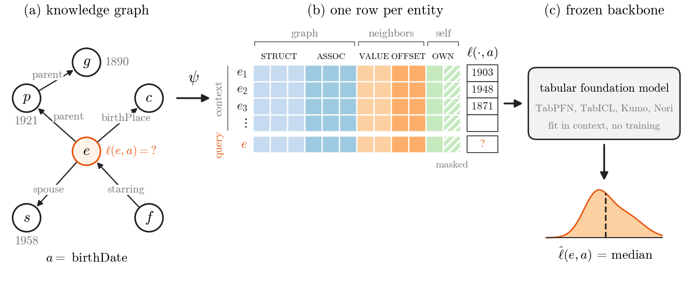

# Tab-LIT: Numeric Literal Prediction with Tabular Foundation Models

Repository for "Numeric Literal Prediction with Tabular Foundation Models". Each knowledge graph becomes one table with a row per entity. A frozen tabular foundation model then predicts each numeric attribute in context from that table, and nothing is trained. The package also reproduces the language-model comparison: Qwen3-8B answering directly, and its answers added to the table as a column.



Prediction of one attribute, here `birthDate`. (a) The knowledge graph with the
training values of the attribute. (b) The conversion gives one row per entity
with five blocks of columns. The attribute's own column is masked on every row,
and the entities with a training value form the context. (c) A frozen tabular
foundation model is fitted in context, and the median of its predictive
distribution is the prediction for the query entity. Values are illustrative.


## What is in it

Backbones (`src/runner.py`), each decoded at its predictive median:

| Name | Model | Package |
|---|---|---|
| `tabpfn` | TabPFN-3.5 | `tabpfn` 9.2.0 |
| `tabicl` | TabICLv2 | `tabicl` 2.2.0 |
| `kumo` | Kumo-Tabular, large | `structured-data-models` 0.2.1 |
| `nori` | Nori-1.5 | `synthefy-nori` 0.22.0 |
| `gbt` | gradient-boosted trees, absolute-error loss | `scikit-learn`; needs no weights, so it is also the smoke test |

The conversion (`src/featurizer.py`) has five blocks, and `full` uses all of
them:

| Block | Feature group | Columns |
|---|---|---|
| struct | `structural` | degrees, PageRank, 14 Laplacian eigenvectors |
| assoc | `association` | 128-d SVD of the (relation, neighbor) incidence matrix |
| value | `neighbor_literal` | mean, max, min and count of the neighbors' values, per attribute |
| offset | `mrap_prior` | relation-offset estimates of each attribute, from training values only |
| own | `own_literal` | the entity's own training values; the target's column is masked |

`full_llm` adds a column of language-model answers
([below](#language-model-for-literal-prediction)), and the block-ablation arms are
also in `CONVERSIONS`.

The MrAP rerun (`src/mrap.py`) scores MrAP on the same test rows, following its
released protocol: offsets are estimated from all literals, test included, over
all triples.

Datasets: DB15K, FB15k-237 and YAGO15k, read from `$TABLIT_KG_ROOT/<dataset>`
(default `../KGs`). Each dataset needs `train/valid/test.txt` triples and
`literals/{train,valid,test}.txt` (entity, attribute, value), used as shipped.
The `KGs/` folder of the LitEm repository below has all three in this layout,
byte for byte the files the results were computed on. FB15k-237 also needs
`entity2text.txt` (Freebase id, label) to name its entities in prompts, as
distributed with KG-BERT; it is read only when the language model is asked
again.

## Results

Means over seeds 1 to 3, on attributes with more than 40 test rows. A cell is
left empty (`--`) unless all three seeds ran. LitEm is not rerun. Its values are
means over the five runs behind the LitEm paper's tables (TransE, d = 128; Table 2
for FB15k-237 and YAGO15k, Table 4 for DB15K), read from those runs' result
files into `results/<dataset>_litem.csv`. The MAE matches the paper. The paper
does not print RMSE, but the run files hold it. LitEm saved no predictions, so
its R² is recovered from the RMSE on its own test rows. These are the same rows
as ours, except DB15K `birthDate`, where LitEm also scores 2 literals whose
entity is missing from the training graph (504 rows, not 502).
MrAP is rerun as described above. Package versions per run are in
`results/*_manifest.json`. Dates are in years, coordinates in degrees, heights
in meters.

### Shipped splits: MAE, RMSE and R²

Each attribute has three rows. R² is computed against the training mean, so a
negative value is worse than predicting that mean. Bold marks the best value
(lowest MAE and RMSE, highest R²) and italics the second best.

<!-- BEGIN GENERATED SHIPPED -->
| Attribute | n | Metric | LitEm | MrAP | TabPFN-3.5 | TabICLv2 | Kumo-Tabular |
|---|---:|---|---:|---:|---:|---:|---:|
| **FB15k-237** | | | | | | | |
| date_of_birth | 454 | MAE | *11.935* | 14.551 | 12.703 | 15.706 | **10.595** |
|  |  | RMSE | *50.907* | **45.068** | 77.604 | 105.1 | 54.500 |
|  |  | R² | *0.896* | **0.919** | 0.760 | 0.559 | 0.881 |
| latitude | 335 | MAE | 2.596 | 1.707 | *1.447* | 2.376 | **1.324** |
|  |  | RMSE | 5.464 | **3.813** | *3.860* | 7.374 | 3.968 |
|  |  | R² | 0.923 | **0.962** | *0.961* | 0.859 | 0.959 |
| longitude | 324 | MAE | 4.424 | 4.163 | *3.202* | 3.330 | **3.043** |
|  |  | RMSE | 15.404 | **14.388** | 17.618 | *14.439* | 18.505 |
|  |  | R² | 0.947 | **0.954** | 0.931 | *0.954* | 0.924 |
| height_meters | 276 | MAE | 0.0756 | 0.0823 | *0.0645* | 0.0650 | **0.0636** |
|  |  | RMSE | 0.0965 | 0.102 | *0.0802* | 0.0803 | **0.0793** |
|  |  | R² | 0.014 | -0.107 | *0.319* | 0.318 | **0.334** |
| pop._number (10^6) | 220 | MAE | *2.330* | 24.356 | 2.356 | 2.701 | **1.562** |
|  |  | RMSE | *10.585* | 126.1 | 11.848 | 15.987 | **7.504** |
|  |  | R² | *0.503* | -69.345 | 0.379 | -0.343 | **0.749** |
| loc.area (10^6) | 214 | MAE | **1.373** | 1.894 | 1.507 | 1.396 | *1.377* |
|  |  | RMSE | 12.279 | 12.250 | 12.575 | *12.130* | **11.700** |
|  |  | R² | 0.058 | 0.063 | 0.012 | *0.081* | **0.145** |
| release_date | 180 | MAE | **3.449** | 5.827 | *3.511* | 3.819 | 3.579 |
|  |  | RMSE | **4.859** | 7.947 | *6.311* | 6.530 | 6.424 |
|  |  | R² | **0.908** | 0.754 | *0.845* | 0.834 | 0.839 |
| date_of_death | 123 | MAE | 15.752 | *14.402* | 17.890 | **13.365** | 15.197 |
|  |  | RMSE | *26.629* | **24.817** | 92.106 | 45.142 | 62.519 |
|  |  | R² | *0.980* | **0.983** | 0.761 | 0.942 | 0.888 |
| org.date_founded | 112 | MAE | *47.762* | 62.594 | 48.768 | 49.703 | **45.951** |
|  |  | RMSE | **85.845** | 102.8 | 96.280 | 97.023 | *90.960* |
|  |  | R² | **0.570** | 0.385 | 0.461 | 0.452 | *0.518* |
| loc.date_founded | 71 | MAE | 149.2 | 206.6 | *143.3* | 145.7 | **141.8** |
|  |  | RMSE | *599.8* | 624.1 | 610.7 | **598.4** | 605.3 |
|  |  | R² | *0.086* | 0.010 | 0.052 | **0.090** | 0.069 |
| **YAGO15k** | | | | | | | |
| BornOnDate | 837 | MAE | 13.242 | 17.738 | *10.944* | 11.578 | **10.460** |
|  |  | RMSE | 23.713 | 30.934 | *18.073* | 20.705 | **16.832** |
|  |  | R² | 0.771 | 0.610 | *0.867* | 0.825 | **0.885** |
| CreatedOnDate | 651 | MAE | 57.206 | 67.857 | **43.457** | 48.128 | *43.962* |
|  |  | RMSE | 141.3 | 145.0 | **118.0** | 128.7 | *122.8* |
|  |  | R² | 0.183 | 0.139 | **0.431** | 0.322 | *0.383* |
| Latitude | 309 | MAE | 1.703 | 1.965 | **1.223** | 1.378 | *1.248* |
|  |  | RMSE | **3.243** | 4.592 | *3.436* | 3.578 | 3.783 |
|  |  | R² | **0.950** | 0.900 | *0.944* | 0.939 | 0.932 |
| Longitude | 294 | MAE | 5.598 | 5.915 | *3.681* | 4.455 | **3.023** |
|  |  | RMSE | 15.631 | 17.380 | *14.655* | 18.570 | **14.401** |
|  |  | R² | *0.952* | 0.941 | **0.958** | 0.932 | 0.951 |
| diedOnDate | 169 | MAE | 30.135 | 36.085 | 21.992 | *21.800* | **19.963** |
|  |  | RMSE | 77.681 | 99.037 | 60.056 | *50.789* | **44.974** |
|  |  | R² | 0.788 | 0.667 | 0.878 | *0.912* | **0.931** |
| DestroyedOnDate | 58 | MAE | 21.673 | 39.724 | **18.179** | 21.195 | *19.361* |
|  |  | RMSE | 37.006 | 84.106 | **34.350** | 36.550 | *34.724* |
|  |  | R² | 0.567 | -1.215 | **0.631** | 0.582 | *0.622* |
| **DB15K** | | | | | | | |
| birthDate | 502 | MAE | 13.212 | 18.214 | *11.319* | 11.650 | **11.091** |
|  |  | RMSE | 20.345 | 26.931 | *15.985* | 16.260 | **15.514** |
|  |  | R² | 0.650 | 0.389 | *0.785* | 0.777 | **0.797** |
| longitude | 193 | MAE | 11.776 | 16.992 | *7.869* | 11.062 | **7.180** |
|  |  | RMSE | 34.122 | 37.100 | *27.551* | 33.651 | **27.506** |
|  |  | R² | 0.759 | 0.718 | *0.844* | 0.768 | **0.845** |
| latitude | 188 | MAE | 3.758 | 6.299 | *3.108* | 3.525 | **2.669** |
|  |  | RMSE | **8.229** | 14.294 | 8.903 | 9.321 | *8.543* |
|  |  | R² | **0.781** | 0.345 | 0.746 | 0.721 | *0.766* |
| deathDate | 121 | MAE | 15.825 | 17.422 | *11.272* | 11.821 | **11.069** |
|  |  | RMSE | 25.665 | 23.627 | *17.405* | 17.944 | **17.119** |
|  |  | R² | 0.556 | 0.626 | *0.797* | 0.784 | **0.804** |
| foundingDate | 86 | MAE | 40.270 | 44.468 | *30.401* | **30.182** | 32.143 |
|  |  | RMSE | 57.406 | 59.998 | *44.722* | **43.760** | 47.199 |
|  |  | R² | 0.169 | 0.097 | *0.498* | **0.519** | 0.441 |

Lower MAE than both LitEm and MrAP: TabPFN-3.5 15/21; TabICLv2 15/21; Kumo-Tabular 18/21.
<!-- END GENERATED SHIPPED -->

## Language model for literal prediction

Qwen3-8B (`src/llm.py`) is used in two ways. As a baseline, it answers each
test row directly. As a feature, its answers become one extra column of the
table. Both uses start from a prompt that names one entity and one attribute and
asks for the value only.

### Prompts

Each test row is asked three ways, which differ in what the model sees:

| Prompt | `arm` | The model sees |
|---|---|---|
| name only | `name` | the entity's name |
| one-hop triples | `graph` | the entity hidden as X, with up to 30 of its triples from the training graph |
| triples, neighbor values | `graph_values` | the same kind of triples, each followed by up to three training values of the neighbor |

Here are the three prompts for DB15K's `birthDate` of Roy Haynes. The name-only
prompt is:

```text
What is the date of birth of Roy Haynes?

Answer with the value only, as YYYY-MM-DD (YYYY alone if only the year is known; a minus sign for BCE). If unsure, give your best estimate.
```

The two triples prompts are built from the training graph and the training
literals. The model has no access to the dataset: each bracketed number is
looked up in `literals/train.txt` by `src/llm.py` and printed into the prompt
as text. For a test row (entity, attribute):

1. Every training triple with the entity as head or tail is collected, and the
   entity is replaced by X. The other entity and the relation are written as
   readable names: the last segment of the IRI for DB15K and YAGO15k, and the
   label from `entity2text.txt` for FB15k-237. A triple that the graph file
   repeats is listed once.
2. For `graph_values` only, each neighbor is looked up in the training literals,
   and up to three of its values are written in brackets after the triple. The
   asked attribute comes first if the neighbor has it, and the neighbor's other
   attributes follow in alphabetical order. Dates are written as year and month
   (`1955-03`), and heights, weights and areas carry their unit.
3. If more than 30 triples remain, 30 are kept. For `graph_values`, the triples
   whose neighbor has a value of the asked attribute are kept first, then those
   whose neighbor has any value, then the rest, in random order within each
   group. For `graph`, the 30 are a random choice. One random generator, seeded
   with 1, serves all rows.
4. The kept triples go above the question, with X in place of the entity's name.

The entity's own values are never shown, and only training triples and training
values are read, so no test value can appear in a prompt. The prompt does not
say how a neighbor's value relates to the asked one. The model has to infer
whether, for example, the latitude of a person's birthplace or the death date
of a collaborator says anything about the asked value.

The `graph_values` prompt for Roy Haynes, shortened:

```text
An entity X is described by these facts (known values of related entities in brackets):
(X, genre, Bebop)
(X, birthPlace, Boston)  [latitude = 42.3581]
(X, associatedMusicalArtist, Charlie Parker)  [date of death = 1955-03]
(X, instrument, Drum kit)
(Hollywood Records, associatedMusicalArtist, X)
...

What is the date of birth of X?

Answer with the value only, as YYYY-MM-DD (YYYY alone if only the year is known; a minus sign for BCE). If unsure, give your best estimate.
```

The `graph` prompt is the same without the bracketed values. Its first line is
unchanged and still mentions values in brackets.

The format hint depends on the attribute. Dates are asked for as `YYYY-MM-DD`,
coordinates in decimal degrees (negative for south or west), height in meters,
area in square kilometers, and population as a number of people. The prompts
spell the units "metres" and "kilometres".

### Decoding and parsing

Generation is greedy, with Qwen3's thinking mode
disabled and at most 24 new tokens. The parser takes the first number in the
reply. For dates it tries a full ISO date first, then year and month, then a
bare year, so that a verbose reply gives its year rather than its day. It then
converts the date to the dataset's own encoding: `year + (day of year − 1)/365`
for DB15K, `year + month/12` for FB15k-237, and `yyyy.mmdd` for YAGO15k. For
coordinates, a decimal number is preferred over an integer found elsewhere in
the reply.

If a reply contains no number, the same prompt is asked once more with the
answer prefilled as "My best estimate is", and the continuation is parsed. If
that still fails, the score uses the training median of the attribute.

The retry matters mostly when the entity is anonymized: a third to over half of
the first replies to the triples-only prompt contain no number. After the
retry, almost every reply parses:

| Dataset | Rows per prompt | Retried: name / triples / with values | Parsed after retry |
|---|---:|---|---:|
| DB15K | 1,181 | 1.5% / 40.7% / 22.3% | 100% |
| FB15k-237 | 2,326 | 0.5% / 33.9% / 19.4% | 100% |
| YAGO15k | 2,354 | 0.6% / 58.8% / 17.0% | ≥ 99.96% |

### As a column

For the `full_llm` conversion, the name-only prompt is asked
for every (entity, attribute) cell in the train, validation and test splits, not
only the test rows. The parsed answers form the `llm_answer` group: one column
`llm::<a>` per attribute, `NaN` where a cell was not asked. The answer depends
on the entity's name alone and reads no literal value, so it is the same for
context and query rows. Which cells were asked does reveal which attributes an
entity has, so when predicting attribute `a`, every `llm::<b>` with `b` other
than `a` is masked. The backbone then sees the model's guess for the target as
one more feature and learns from the context rows how far to trust it.

### Files

The parsed replies ship, so nothing needs the 16 GB model unless these files
are deleted:

| File | Contents |
|---|---|
| `llm/<dataset>_answers.csv` | name-only reply and parsed value for every cell (the answer column) |
| `llm/<dataset>_direct.csv` | the three prompts' replies for each test row, with a flag for whether it was retried |
| `results/<dataset>_llm_direct.csv` | per-attribute MAE, MASE and parse rate of each prompt type |
| `llm/cache/qwen3-8b.jsonl` | not tracked: raw generations keyed by model, prefix and prompt, written by `llm`; a rerun asks only for prompts missing here |

### Results: MASE

MASE is the MAE divided by the MAE of always predicting the attribute's
training median, so 1.00 means no better than that constant. Each row gives the
median MASE over the 21 attributes of the main table (more than 40 test rows),
and how many of them have a MASE below 1. The rows differ in what produces the
prediction:

| Row | Protocol |
|---|---|
| name only, one-hop triples, triples, neighbor values | Qwen3-8B answers each test row from the matching prompt above, in one greedy run. A reply with no number after the retry is scored as the training median. |
| conversion | The backbone is fitted in context on the `full` table, as in the main results table. MASE is averaged over seeds 1 to 3 per attribute, and an attribute counts only if all three seeds ran. |
| + answer column | As for conversion, on the `full_llm` table, which adds Qwen3-8B's name-only answers as the `llm::<a>` columns. |

Qwen3-8B was trained on web text that may state the true values. The name-only
rows and the answer-column rows therefore measure what the model remembers, not
what the graph supports, and are kept apart from the main table.

<!-- BEGIN GENERATED LLM -->
| Table or prompt | Learner | Median MASE | MASE < 1 | Attributes |
|---|---|---:|---:|---:|
| name only | Qwen3-8B | 0.689 | 15 | 21 |
| one-hop triples | Qwen3-8B | 1.056 | 9 | 21 |
| triples, neighbor values | Qwen3-8B | 1.597 | 8 | 21 |
| conversion | Kumo-Tabular | 0.430 | 21 | 21 |
|  | TabPFN-3.5 | 0.450 | 21 | 21 |
|  | GBT | 0.553 | 21 | 21 |
| + answer column | Kumo-Tabular | -- | 0 | 0 |
|  | TabPFN-3.5 | -- | 0 | 0 |
|  | GBT | 0.430 | 21 | 21 |

Attributes where the answer column lowers MASE: GBT 20/21.
<!-- END GENERATED LLM -->

## Install

```bash
conda env create -f environment.yml && conda activate tab-lit
# or: pip install -r requirements.txt
```

TabPFN 9 downloads its weights after a one-time license acceptance; for an
unattended run, set `TABPFN_TOKEN` (<https://ux.priorlabs.ai/account>). The
other models download from Hugging Face without a token. A GPU is needed in
practice. The paper ran everything on one RTX 3090 (24 GB).

The datasets and the MrAP script come from the LitEm repository:

```bash
git clone -b paper-reproduction https://github.com/dice-group/literal-embeddings
export TABLIT_KG_ROOT=$PWD/literal-embeddings/KGs
export MRAP_DIR=$PWD/literal-embeddings/MrAP
```

## Run

From inside the repository:

```bash
# one fit, no weights needed
python -m src.main run --dataset DB15K --backbone gbt

# the tables above from the shipped results, no GPU needed
python -m src.main report

# everything in the tables, then rewrite them in this file
MRAP_DIR=... ./run_all.sh

# or step by step
python -m src.main llm            # replies to llm/, direct scores to results/
python -m src.main experiment --backbones tabpfn tabicl kumo nori gbt
python -m src.main experiment --backbones kumo tabpfn gbt --conversion full_llm
python -m src.main mrap
python -m src.main litem --litem_dir ...  # LitEm's run files; the results ship
python -m src.main report --readme
```

`experiment` writes `results/<dataset>_<backbone>_<conversion>.csv`, with one
row per attribute, seed and split (test and validation), and a manifest with the
package versions and the time per seed. Existing files are skipped unless you
pass `--overwrite`. `llm` reads its replies from `llm/cache/` and asks Qwen3-8B
only for prompts missing there.

On one RTX 3090, TabPFN-3.5, TabICLv2, Kumo-Tabular and GBT take about 25
minutes together on the three datasets. Nori-1.5 takes hours, most of it on
YAGO15k, whose largest attributes do not fit in 24 GB and fall back to the CPU.
Asking Qwen3-8B again takes about an hour.

`report` reads only `results/` and recomputes nothing, so it runs without a
GPU, weights or datasets. It refuses to pool two files that were scored on
different test rows for the same attribute and seed. `pytest tests` checks the
feature groups, the target masking, answer parsing and the table code without a
GPU.

## Reproducibility

TabPFN-3.5 and TabICLv2 are deterministic for a given seed. Rerunning them here
gave the same per-attribute MAE as the runs behind the paper's main table,
within 0.005%. The MrAP rerun matches to floating-point precision. The prompts
`src/llm.py` builds are byte-identical to the ones the paper's replies were
generated from, and the shipped replies parse to the same values.

The paper's GBT rows were run under numpy 1.26 and scipy 1.16, not the
versions pinned here. The feature table differs slightly between the two
(SVD and eigenvector numerics), and GBT follows it. Under those versions the
package reproduces the paper's GBT rows exactly; under the pinned ones a GBT
cell moves by a median of 1% to 2% per attribute.

Kumo-Tabular is not deterministic on the GPU. Two runs of the same seeds
differed by a median of 0.7% to 3.1% in per-attribute MAE, depending on the
dataset, and by at most 9.5% (on FB15k-237). Read a Kumo-Tabular cell to about
two significant figures.

The seed fixes the context subsample, the cross-fitting folds, the association
SVD and the backbone's own randomness. The splits do not depend on it.
